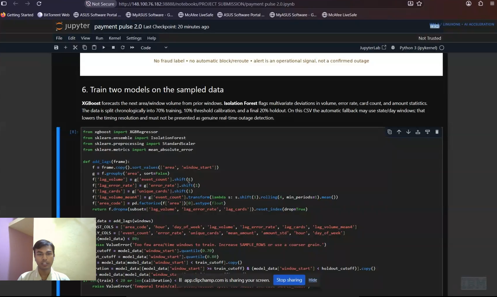

# Payment Pulse — Payment Disruption Early Warning

**IBM Z Datathon theme:** Real-Time AI for Critical Decisions  
**Team:** Anurag Katariya · Kanishka Agarwal · Dhruvi Thakkar · Ayush Kumar Raunak

Payment Pulse is an AI-assisted operational monitoring prototype. It analyzes transaction activity in area/time windows, forecasts expected payment volume, and flags unusual changes so an operator can investigate quickly.

> This notebook replays historical transaction data. It is not connected to a live payment stream. The disruption evaluation uses injected scenarios because this dataset has no independently verified outage labels. Alerts are operational signals for human review; they do not confirm outages, detect fraud, or block/reroute payments.

## L1CC execution evidence

The main notebook was run in JupyterLab on IBM LinuxONE Community Cloud (L1CC). The screenshot shows the Payment Pulse notebook open on the L1CC-hosted JupyterLab instance while the model-training section is in view.



## Decision-support flow


1. Load the included sampled transaction CSV and check its required columns.
2. Sample across the file, then aggregate transactions into area/time windows.
3. Train an XGBoost forecaster and an Isolation Forest anomaly detector.
4. Evaluate on a chronological holdout and injected scenarios; plot results and show an operator-facing alert/replay.
5. An operator reviews the signal and decides whether to monitor or escalate.

## Dataset and analysis

- `payment_pulse_synthetic_29mb.csv` is a **29.0 MB** uniformly sampled copy (313,343 transaction rows, 15 columns) of the original 345,000-row CSV. The original source is not included.
- The notebook samples up to 150,000 rows uniformly across the available file, then derives area/time features such as event count, error rate, distinct-card count, and amount statistics.
- `Is Fraud?` is deliberately excluded from model features and operational decisioning.
- XGBoost forecasts next-window event volume. Isolation Forest scores multivariate deviations in volume, error rate, card count, and transaction amount statistics.
- The chronological split is 70% training, 10% threshold calibration, and 20% final holdout.
- The notebook reports volume MAE and precision, recall, and F1 for **injected synthetic disruption scenarios only**. These are demonstration metrics, not measured real-world outage-detection performance.
- On this dataset, the notebook may aggregate at a coarser state/day resolution when city/hour windows are too sparse. That reduces time resolution and should be disclosed in a demo.

The notebook generates data profiles, area-volume comparisons, observed-versus-forecast plots, operational alert charts, and scenario evaluation figures. The `assets/` folder contains the three explanatory illustrations used in its first sections.

## Main project files

| File | Purpose |
| --- | --- |
| `payment pulse 2.0.ipynb` | Main explained notebook: data loading, profiling, aggregation, model training, evaluation, graphs, replay, and optional Granite summary. |
| `payment_pulse_synthetic_29mb.csv` | Smaller project dataset for upload and notebook execution. |
| `assets/` | Notebook illustrations and L1CC run screenshot. |
| `labs/` | Four completed IBM LinuxONE ML lab notebooks. |

## Four mandatory lab notebooks

These reference labs are included separately from the original Payment Pulse project so reviewers can inspect both the required exercises and the team's distinct hackathon solution.

1. **Fraud LSTM (Keras/TensorFlow)** — sequence-based classification of credit-card transactions.
2. **Client churn (Scikit-learn/PyTorch)** — transaction/customer analysis and churn prediction.
3. **Digit classification (TensorFlow)** — MNIST image classification and model export to ONNX.
4. **Loan approval demo** — predictive and generative AI workflow with document processing and retrieval-augmented generation.

## L1CC and Docker workload

The notebook ran in the LinuxONE Community Cloud ML lab's JupyterLab container, using the provided IBM Z / s390x image:

```text
registry.linuxone.cloud.marist.edu/l1cc/jupyterlab-image-s390x:latest
```

The lab container is named `notebook`, uses host networking, mounts `/home/linux1/shared` into JupyterLab's `shared` folder, and serves JupyterLab on TCP port `38888`. The lab documents this deployment in the [official JupyterLab ML repository](https://github.com/linuxone-community-cloud/jupyter-lab-ml). The VM is accessed with SSH key authentication; JupyterLab uses its configured token authentication.

This is a containerized notebook workload on LinuxONE. The project does not include a custom Payment Pulse Docker image or standalone scoring API. No Telum AI accelerator use or production-grade security assessment is claimed.

### Run the notebook

1. Start the L1CC JupyterLab container using the official lab instructions.
2. Upload `payment pulse 2.0.ipynb`, `payment_pulse_synthetic_29mb.csv`, and the `assets/` folder (preserve the folder structure). Alternatively, place the CSV in the mounted `shared/` directory.
3. Open the notebook, select **Kernel → Restart Kernel**, then **Run → Run All Cells**.
4. Review the printed dataset path and row counts, holdout metrics, plots, and replay alerts. If optional Granite credentials are unavailable, skip that cell's prompts.

## Security and responsible use

- The repository excludes SSH private keys (`.pem`/`.key`) and environment files. Never upload credentials or Jupyter tokens.
- Use SSH key authentication for VM administration and the lab's Jupyter token for notebook access. Do not publish either secret.
- The notebook omits the fraud label and surfaces aggregate operational signals for human review. It does not make individual consumer decisions or take automatic payment actions.
- The supplied lab container uses host networking and a writable shared folder for the lab workflow. This is not a hardened production deployment; do not expose it beyond the intended lab access controls.
- The optional Granite summary is not required for the core workflow and must receive aggregate summaries only. The notebook does not require an IBM Cloud API key to run the main pipeline.

## Repository layout

```text
.
├── README.md
├── payment pulse 2.0.ipynb
├── payment_pulse_synthetic_29mb.csv
├── assets/
│   ├── l1cc-payment-pulse-run.png
│   ├── step1-data-loading.png
│   ├── step2-data-profile.png
│   └── step3-aggregation-flow.png
└── labs/
    ├── Churn_Scikit_PyTorch.ipynb
    ├── Digit_Class_TensorFlow.ipynb
    ├── Fraud_LSTM_Keras_TF.ipynb
    └── Loan_Approval_Demo.ipynb
```
