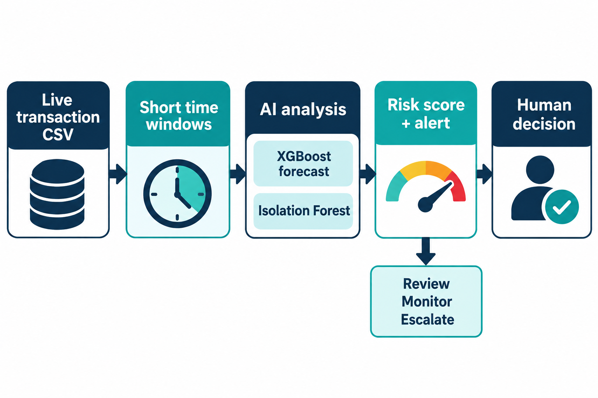

# Payment Pulse: Merchant Payment Disruption Early Warning

Payment Pulse is a guided Jupyter notebook prototype for the IBM Z Datathon theme **Real-Time AI for Critical Decisions**. It reads transaction records from CSV, groups them into short city/hour windows, forecasts expected activity with XGBoost, and flags unusual patterns with Isolation Forest for an operator to review.

The notebook has been run on IBM LinuxONE Community Cloud (L1CC) in the supplied s390x JupyterLab environment. The current demo replays a historical CSV; it is not connected to a live payment stream. The dataset has no verified outage labels, so the notebook injects synthetic disruption scenarios to demonstrate evaluation and alerting.

## Workflow



Transaction rows become city/hour windows. The models produce a forecast and anomaly signal. An alert asks a human operator to review, monitor, or escalate; the notebook does not block or reroute payments.

## Graphs and analysis

When run, the notebook generates these charts from the selected CSV:

| Chart | What it shows |
| --- | --- |
| Hourly volume and error distributions | Historical transaction counts and recorded errors by city/hour window. |
| Top 10 areas by transaction volume | The busiest city/state areas in the loaded sample. |
| Observed versus forecast activity | Actual and XGBoost forecast volume over time, with alert windows marked. |
| Operational error signals | Recorded error rates alongside the demo error-spike threshold. |
| Synthetic incident-check confusion matrix | Alert classifications against injected disruption scenarios. |

Values vary with the CSV and sample. The notebook also displays an overview graphic and the input-to-output diagram from `assets/`.

## Project files

- `Payment_Pulse_Disruption_Early_Warning.ipynb` — explanations, data loading and checks, model training, metrics, charts, replay example, and optional Granite summary.
- `assets/payment-pulse-overview.png` — overview illustration.
- `assets/payment-pulse-transaction-flow.png` — input-to-output workflow graphic.
- `PaymentPulse_Notebook.zip` — notebook, README, and both image assets. The large CSV and credentials are excluded.
- `card_transaction.v1.csv` — local input dataset, if present. Upload the required CSV to L1CC separately; it is not inside the ZIP.

## Run on L1CC JupyterLab

The notebook has been run in the JupyterLab environment provided by the LinuxONE Community Cloud ML lab. You do not need to build or start another Docker container if the existing JupyterLab is running.

1. Open the existing L1CC JupyterLab URL. If using an SSH tunnel, keep its PowerShell window open while using the browser. JupyterLab may request its token again after reconnecting.
2. Upload and extract `PaymentPulse_Notebook.zip` into the JupyterLab home folder. For direct upload, put the notebook in the home folder beside the CSV and put both PNGs in an `assets` subfolder beside the notebook.
3. Make `transactions_history.csv` available beside the notebook or at `~/shared/transactions_history.csv`. The notebook also checks for `card_transaction.v1.csv` beside itself.
4. Open the notebook, choose **Kernel → Restart Kernel**, then **Run → Run All Cells**.

The loader reads at most 150,000 rows by default to limit memory use. It prints the selected input path and loaded sample size near the start. Increase `SAMPLE_ROWS` only after checking available VM memory.

## Docker and LinuxONE workload

The current workload runs as a notebook inside the L1CC-provided Docker image for IBM Z/LinuxONE (`s390x`):

```text
registry.linuxone.cloud.marist.edu/l1cc/jupyterlab-image-s390x:latest
```

The lab configuration uses a container named `notebook`, the VM's host network, and a shared-folder mount from `/home/linux1/shared` on the VM to `/home/ibm-user/shared` in the container. JupyterLab uses port `38888`; this project was accessed through an SSH tunnel. The image includes common ML libraries used by the notebook, including pandas, scikit-learn, and XGBoost.

To inspect the already-running lab container from an SSH shell on the VM:

```bash
docker ps --filter name=notebook
docker logs --tail 50 notebook
```

This is a containerized **notebook workload**. There is no custom Payment Pulse Dockerfile or standalone scoring API in this project folder. A separate service image would be additional work if the judging panel requires an independently deployed application container.

The notebook runs on CPU with a bounded 150,000-row sample. It trains an XGBoost volume forecaster (histogram tree method, 120 estimators, depth 4) and a 120-estimator Isolation Forest over city/hour features. It reports holdout volume MAE and synthetic-scenario precision, recall, and F1.

## Security design and operational limits

- Access JupyterLab through the L1CC SSH tunnel and retain token authentication. Do not publish or share the token.
- Never commit or upload private SSH `.pem` keys, IBM Cloud API keys, or watsonx.ai project IDs. `.gitignore` excludes `.pem`, `.key`, and CSV files; still verify files before sharing an archive.
- The notebook drops the `Is Fraud?` label and scores aggregated city/hour operating signals, rather than making person-level fraud decisions.
- The optional Granite call receives aggregate summary metrics only. It is not required to run analysis; press Enter at both credential prompts to skip it. Do not paste the SSH key into these prompts.
- The prebuilt lab container uses host networking and a writable shared-folder mount for the lab workflow. These are lab settings, not a hardened production deployment. For a separate hardened container, use a non-root user, read-only data mount, resource limits, minimal network exposure, and secrets injected at runtime rather than stored in the image.
- Alerts are human decision support. The model cannot confirm an outage or trigger an automatic payment action.

## Metrics and L1CC run evidence

Precision, recall, and F1 are calculated against injected synthetic disruption scenarios only; they are not real-world outage performance. Reliable outage evaluation requires independently verified incident timestamps.

The project author reports a successful run on L1CC. A screenshot showing the completed Payment Pulse notebook with generated charts is still needed as visual evidence. Add it as `assets/l1cc-payment-pulse-run.png` and embed it here before submission. The screenshots currently available show setup or optional-credential errors, so they are not presented as successful-run proof.
